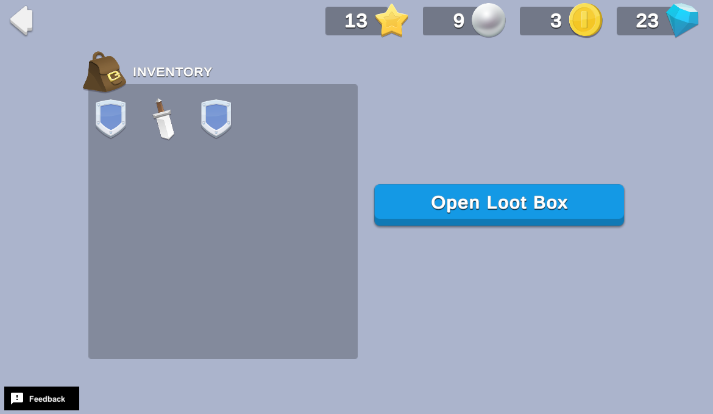

# Loot Boxes With Cooldown

Whether they're receiving items, currencies, extra lives, or power-ups, players love free stuff! Awarding daily gifts to players that return to your game boosts engagement, intrinsic motivation to check in regularly, and overall interest in your game. Daily rewards can also act as a precursor to introducing monetized in-app purchases in the future.

This sample demonstrates how to grant randomized rewards on a timed cooldown. After a player claims their reward, they must wait a preset amount of time before claiming another reward.

## Overview

To see this use case in action:

1. In the Unity Editor **Project** window, select **Assets**.
2. Double-click `Start Here.unity` to open the samples menu scene.
3. Enter **Play Mode**.
4. Click **Loot Boxes with Cooldown** to interact with this use case.

### Initialization

1. The `DailyRewardsSceneManager` script initializes Unity Gaming Services in its `Start` function.
2. The game retrieves and updates values from the player's `player_economy` Cloud Save key.

### Functionality

When you click the **Claim Daily Reward** button, you receive a random amount of rewards from the available pool (indicated in the currency HUD). For demonstration purposes, the cooldown is set to 60 seconds. The following occurs on the backend:

1. The button's `OnClick` method calls Cloud Code to execute the `GrantTimedRandomReward` function, which picks random currencies and inventory items from internal lists to award.
2. The function grants the reward in the player's `player_economy` Cloud Save record (wallet and inventory) and returns the final results to the calling Unity C# script.

This example also uses Cloud Code to access Cloud Save to implement a cooldown between rewards and returns:

- A flag if the **Claim Daily Rewards** button should be enabled.
- The current cooldown in seconds.
- The default cooldown needed to reset the timer locally when a reward is claimed.

**Note**: This sample also includes enhanced error handling to catch and resolve issues that arise from calling the backend services too frequently (more than five times per second), which triggers an exception with a rate-limited reason. This sample catches the exception, pauses .1 seconds with exponential back-off, and then retries until it succeeds.

## Setup

### Requirements

To replicate this use case, you need the following [Unity packages](https://docs.unity3d.com/Manual/Packages.html) in your project:

| **Package**                                                                           | **Role**                                                                                                                                                   |
|---------------------------------------------------------------------------------------|------------------------------------------------------------------------------------------------------------------------------------------------------------|
| [Authentication](https://docs.unity.com/authentication/IntroUnityAuthentication.html) | Automatically signs in the player as an anonymous user to keep track of their data server-side.                                                            |
| [Cloud Code](https://docs.unity.com/cloud-code/implementation.html)                   | Accesses the cooldown status, picks and grants random currency and inventory items through the `SampleGameModule` module, and then returns the result of the reward. |
| [Cloud Save](https://docs.unity.com/cloud-save/index.html#Implementation)             | Stores the player's currency balances and inventory in the `player_economy` key, and the last granted reward time to allow cooldown values to persist between sessions. The `LOOT_BOX_COOLDOWN_GRANT_REWARD_TIME` and `player_economy` keys are in the protected [access class](https://docs.unity.com/ugs/en-us/manual/cloud-save/manual/concepts/player-data#Access_Classes): the client can read them and only `SampleGameModule` can write them. |
| [Deployment](https://docs.unity3d.com/Packages/com.unity.services.deployment@1.2)     | The Deployment package provides a cohesive interface to deploy assets for Cloud Services.                                                                  |
| [Remote Config](https://docs.unity.com/remote-config)                                 | Provides the currency and inventory item definitions used by the sample.                                                                                   |

To use these services in your game, activate each service for your Organization and project in the [Unity Dashboard](https://dashboard.unity3d.com/).

### Unity Cloud services configuration

To replicate this sample scene's setup in your own Unity project, we need to configure the following items:

- The `SampleGameModule` Cloud Code module
- Remote Config economy catalog values

There are two main ways of doing this, either by [using the Deployment package](#using-the-deployment-package), or by [manually entering them using the Dashboard](#using-the-dashboard).
We recommend the usage of the Deployment package since it will greatly accelerate this process.

#### Using the Deployment package

Here are the steps to deploy configuration using the Deployment package:

1. Open the [Deployment window](https://docs.unity3d.com/Packages/com.unity.services.deployment@1.2/manual/deployment_window.html)
1. Check in `Common` and `Loot Boxes`
1. Click `Deploy Selection`

This will deploy all the necessary items.

#### Using the Dashboard

The [Dashboard](dashboard.unity3d.com) enables you to edit manually all your services configuration by project and environment.
Here are the details necessary for the configuration of the current sample.

##### Cloud Code

The `SampleGameModule` C# Cloud Code module provides the following [module functions](https://docs.unity.com/ugs/en-us/manual/cloud-code/manual/modules):

| **Module function**                | **Parameters** | **Description**                                                                                                                                                                  | **Location in project**                                                                              |
|------------------------------------|----------------|----------------------------------------------------------------------------------------------------------------------------------------------------------------------------------|------------------------------------------------------------------------------------------------------|
| `LootBoxesWithCooldown_Claim`      | None           | Checks if the cooldown has expired (or was never set), then selects a random reward from the reward pool, grants the reward to the player, and then updates the cooldown timer.  | `SampleGameModule/Project/Services/LootBoxesWithCooldownService.cs`                                  |
| `LootBoxesWithCooldown_GetStatus`  | None           | Checks for the last grant time and returns a flag indicating if the player is eligible for a reward, and how many seconds are left in cooldown.                                  | `SampleGameModule/Project/Services/LootBoxesWithCooldownService.cs`                                  |

To publish them, deploy the `SampleGameModule` module (in the repo root `SampleGameModule/` folder) through `Assets/Common/Config as Code/SampleGameModule.ccmr` in the Deployment window, or upload it from the Unity Cloud Dashboard.

##### Remote Config

The economy catalog is stored in Remote Config and deployed from `Assets/Common/Config as Code/economy_config.rc`. The following currencies are defined under the `ECONOMY_CURRENCIES` key and inventory items under the `ECONOMY_ITEMS` key:

| **Resource type** | **Resource name** | **ID**     | **Description**                                             |
|-------------------|-------------------|------------|-------------------------------------------------------------|
| Currency          | Coin              | `COIN`     | A currency for the randomized loot box reward pool.         |
| Currency          | Gem               | `GEM`      | A currency for the randomized loot box reward pool.         |
| Currency          | Pearl             | `PEARL`    | A currency for the randomized loot box reward pool.         |
| Currency          | Star              | `STAR`     | A currency for the randomized loot box reward pool.         |
| Inventory item    | Sword             | `SWORD`    | An inventory item for the randomized loot box reward pool.  |
| Inventory item    | Shield            | `SHIELD`   | An inventory item for the randomized loot box reward pool.  |
