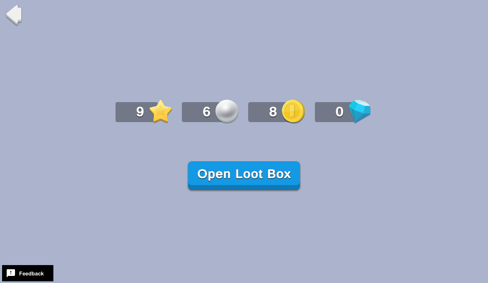

# Loot Boxes

Loot boxes are virtual items that players can win, earn, or purchase, and then open to receive a randomized selection of items. Rewards can vary greatly depending on the game's genre, theme, and virtual economy. They can positively impact retention, supplement live events, and pique the curiosity of old and new players alike.

This sample demonstrates how to set up a basic loot box that grants random currency to players.

## Overview

To see this use case in action:

1. In the Unity Editor **Project** window, select **Assets** > **Use Case Samples** > **Loot Boxes**, and then double-click `LootBoxesSample.unity` to open the sample scene.
2. Enter Play Mode to interact with the use case.

### Initialization

The `LootBoxesSceneManager.cs` script performs the following initialization tasks:

1. Initializes Unity Gaming Services.
2. Signs in the player [anonymously](https://docs.unity.com/authentication/UsingAnonSignIn.html) using the Authentication service. If you’ve previously initialized any of the other sample scenes, Authentication will use your cached Player ID instead of creating a new one.
3. Retrieves and updates currency balances from the player's `player_economy` Cloud Save key for that authenticated user.

### Functionality

When you click the **Open Loot Box** button, you receive a random amount of rewards from the available pool (indicated in the currency HUD). The following occurs on the backend:

1. The button's `OnClick` method calls the `LootBoxes_GrantRandomCurrency` function of the `SampleGameModule` Cloud Code module, which picks a random quantity of a random currency from an internal list to reward the user.
2. The function grants the awarded currency in the player's `player_economy` Cloud Save record.
3. Cloud Code returns the results to the client and updates the UI.

## Setup

### Requirements

To replicate this use case, you need the following [Unity packages](https://docs.unity3d.com/Manual/Packages.html) in your project:

| **Package**                                                                           | **Role**                                                                                             |
|---------------------------------------------------------------------------------------|------------------------------------------------------------------------------------------------------|
| [Authentication](https://docs.unity.com/authentication/IntroUnityAuthentication.html) | Automatically signs in the player as an anonymous user to keep track of their data server-side.      |
| [Cloud Code](https://docs.unity.com/cloud-code/implementation.html)                   | Picks and grants random currency for the loot box through the `SampleGameModule` module and returns the result. |
| [Cloud Save](https://docs.unity.com/cloud-save)                                       | Stores the player's currency balances in the `player_economy` key, which the client reads at runtime. The `player_economy` key is in the protected [access class](https://docs.unity.com/ugs/en-us/manual/cloud-save/manual/concepts/player-data#Access_Classes): the client can read it and only `SampleGameModule` can write it. |
| [Deployment](https://docs.unity3d.com/Packages/com.unity.services.deployment@1.2)     | The Deployment package provides a cohesive interface to deploy assets for Cloud Services.            |
| [Remote Config](https://docs.unity.com/remote-config)                                 | Provides the currency definitions used by the sample.                                                |

To use these services in your game, activate each service for your Organization and project in the [Unity Dashboard](https://dashboard.unity3d.com/).

### Unity Cloud services configuration

To replicate this sample scene's setup in your own Unity project, we need to configure the following items:

- The `SampleGameModule` Cloud Code module
- Remote Config economy catalog values

There are two main ways of doing this, either by [using the Deployment package](#using-the-deployment-package), or by [manually entering them using the Dashboard](#using-the-dashboard).
We recommend the usage of the Deployment package since it will greatly accelerate this process.

#### Using the Deployment package

Here are the steps to deploy configuration using the Deployment package:

1. Open the [Deployment window](https://docs.unity3d.com/Packages/com.unity.services.deployment@1.2/manual/deployment_window.html)
1. Check in `Common` and `Loot Boxes`
1. Click `Deploy Selection`

This will deploy all the necessary items.

#### Using the Dashboard

The [Dashboard](dashboard.unity3d.com) enables you to edit manually all your services configuration by project and environment.
Here are the details necessary for the configuration of the current sample.

##### Cloud Code

The `SampleGameModule` C# Cloud Code module provides the following [module functions](https://docs.unity.com/ugs/en-us/manual/cloud-code/manual/modules):

| **Module function**             | **Parameters** | **Description**                                                                                                                                  | **Location in project**                                                              |
|---------------------------------|----------------|--------------------------------------------------------------------------------------------------------------------------------------------------|--------------------------------------------------------------------------------------|
| `LootBoxes_GrantRandomCurrency` | None           | Picks a random quantity of a random currency from an internal list to reward the user, grants it in the player's `player_economy` Cloud Save record, and returns the result. | `SampleGameModule/Project/Services/LootBoxesService.cs`                              |

To publish them, deploy the `SampleGameModule` module (in the repo root `SampleGameModule/` folder) through `Assets/Common/Config as Code/SampleGameModule.ccmr` in the Deployment window, or upload it from the Unity Cloud Dashboard.

##### Remote Config

The economy catalog is stored in Remote Config and deployed from `Assets/Common/Config as Code/economy_config.rc`. The following currencies are defined under the `ECONOMY_CURRENCIES` key:

| **Resource type** | **Resource name** | **ID**  | **Description**              |
|-------------------|-------------------|---------|------------------------------|
| Currency          | Coin              | `COIN`  | A potential loot box reward. |
| Currency          | Gem               | `GEM`   | A potential loot box reward. |
| Currency          | Pearl             | `PEARL` | A potential loot box reward. |
| Currency          | Star              | `STAR`  | A potential loot box reward. |
