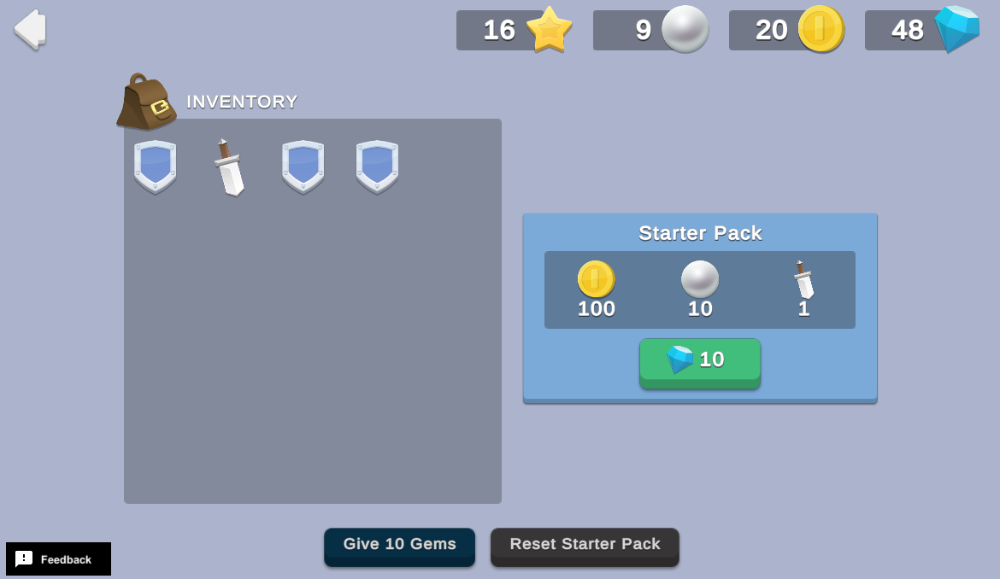

# Starter Pack

Starter packs are one-time deals that grant new players additional resources at a discount. Starter packs improve the onboarding process and boost engagement early, and can also help convert new players to paying users.

This sample demonstrates how to create a one-time starter pack deal in your game that a player can purchase with in-game currency.

## Overview

To see this use case in action:

1. In the Unity Editor **Project** window, select **Assets** > **Use Case Samples** > **Starter Pack**, and then double-click `StarterPackSample.unity` to open the sample scene.
2. Enter Play Mode to interact with the use case.

### Initialization

When the scene loads, the `StarterPackSceneManager.cs` script performs the following initialization tasks:

1. Initializes Unity Gaming Services.
2. Signs in the player [anonymously](https://docs.unity.com/authentication/UsingAnonSignIn.html) using the Authentication service. If you’ve previously initialized any of the other sample scenes, Authentication will use your cached Player ID instead of creating a new one.
3. Retrieves and updates currency balances from the player's `player_economy` Cloud Save key for that authenticated user.

### Functionality

#### Give 10 Gems

In this example, the starter pack costs 10 Gems. For demonstration purposes, this scene provides a button that grants the player 10 Gems each time it is clicked, which ensures enough currency to test the purchase. When you click the **Give 10 Gems** button, the following occurs:

1. The button's `OnClick` method calls the `StarterPackSceneManager` script's `OnGiveTenGemsButtonPressed` function.
2. `TheOnGiveTenGemsButtonPressed` function calls the `SampleGameModule` Cloud Code module (through the `PlayerEconomy` helper) to add 10 Gems to the player's balance, and then the UI code updates the player's resources in the Currency HUD.

**Note**: that the purchase button is temporarily disabled while the currency balance updates.

#### Purchase starter pack

When you click the button to buy the starter pack having 10 or more Gems, the player consumes 10 Gems in exchange for the resources offered in the pack. The following occurs:

1. The button's `OnClick` method calls the `StarterPackSceneManager` script's `OnBuyButtonPressed` function, which sends a request to the Cloud Code service to execute the `StarterPack_PurchaseStarterPack` function of the `SampleGameModule` Cloud Code module.
2. This `StarterPack_PurchaseStarterPack` function queries the Cloud Save service to verify that the player has not yet claimed the deal, and then makes the purchase.
3. If the player has not claimed the deal, the function subtracts 10 Gems from the player's balance and grants the pack's rewards, and then sends an update to the Cloud Save service directly to set a flag that this player has now claimed the deal.
4. The UI code updates the player's resources in the Currency HUD.

The purchase button also updates to indicate that the offer has already been claimed. At this point, you cannot purchase additional starter packs unless you click the **Reset Starter Pack** button, no matter how many Gems you have.

#### Reset Starter Pack

After purchasing a starter pack, the player cannot purchase another one unless they reset their game save. To illustrate this, this scene provides a button to reset the flag so the player can purchase it again. When you click the **Reset Starter Pack** button, the following occurs on the backend:

1. The button's `OnClick` method calls the `StarterPackSceneManager` script's `OnResetPlayerDataButtonPressed` function, which calls the `StarterPack_ResetForDebug` function of the `SampleGameModule` Cloud Code module. The function deletes the claim flag from Cloud Save, so that this player has not yet claimed the deal. The client cannot delete the flag itself, because it is in the protected access class.
2. The UI code re-enables the Starter Pack purchase button.

## Setup

### Requirements

To replicate this use case, you need the following [Unity packages](https://docs.unity3d.com/Manual/Packages.html) in your project:

| **Package**                                                                           | **Role**                                                                                               |
|---------------------------------------------------------------------------------------|--------------------------------------------------------------------------------------------------------|
| [Authentication](https://docs.unity.com/authentication/IntroUnityAuthentication.html) | Signs in the user anonymously to keep track of their data server-side.                                 |
| [Cloud Code](https://docs.unity.com/cloud-code/implementation.html)                   | Stores important validation logic on the server side.                                                  |
| [Cloud Save](https://docs.unity.com/cloud-save/index.html#Implementation)             | Stores small pieces of data, such as a flag that indicates if the user has claimed their starter pack, as well as the player's currency balances and inventory in the `player_economy` key. The `STARTER_PACK_STATUS` and `player_economy` keys are in the protected [access class](https://docs.unity.com/ugs/en-us/manual/cloud-save/manual/concepts/player-data#Access_Classes): the client can read them and only `SampleGameModule` can write them. |
| [Deployment](https://docs.unity3d.com/Packages/com.unity.services.deployment@1.2)     | The Deployment package provides a cohesive interface to deploy assets for Cloud Services.              |
| [Remote Config](https://docs.unity.com/remote-config)                                 | Provides the economy catalog, including the Starter Pack Virtual Purchase definition.                  |

To use these services in your game, activate each service for your Organization and project in the [Unity Dashboard](https://dashboard.unity3d.com/).

### Unity Cloud services configuration

To replicate this sample scene's setup in your own Unity project, we need to configure the following items:

- The `SampleGameModule` Cloud Code module
- Remote Config economy catalog values

There are two main ways of doing this, either by [using the Deployment package](#using-the-deployment-package), or by [manually entering them using the Dashboard](#using-the-dashboard).
We recommend the usage of the Deployment package since it will greatly accelerate this process.

#### Using the Deployment package

Here are the steps to deploy configuration using the Deployment package:

1. Open the [Deployment window](https://docs.unity3d.com/Packages/com.unity.services.deployment@1.2/manual/deployment_window.html)
1. Check in `Common` and `Starter Pack`
1. Click `Deploy Selection`

This will deploy all the necessary items.

#### Using the Dashboard

The [Dashboard](dashboard.unity3d.com) enables you to edit manually all your services configuration by project and environment.
Here are the details necessary for the configuration of the current sample.

##### Cloud Code

The `SampleGameModule` C# Cloud Code module provides the following [module functions](https://docs.unity.com/ugs/en-us/manual/cloud-code/manual/modules):

| **Module function**               | **Parameters** | **Description**                                                                                                                                             | **Location in project**                                                                  |
|-----------------------------------| -------------- | ------------------------------------------------------------------------------------------------------------------------------------------------------------ |-------------------------------------------------------------------------------------------|
| `StarterPack_PurchaseStarterPack` | None           | Queries the Cloud Save service to verify that the player has not yet claimed the deal, before making the purchase.                                | `SampleGameModule/Project/Services/StarterPackService.cs`                                |
| `StarterPack_ResetForDebug`       | None           | Deletes the claim flag so the starter pack can be bought again. For testing only.                                                                 | `SampleGameModule/Project/Services/StarterPackService.cs`                                |

To publish them, deploy the `SampleGameModule` module (in the repo root `SampleGameModule/` folder) through `Assets/Common/Config as Code/SampleGameModule.ccmr` in the Deployment window, or upload it from the Unity Cloud Dashboard.

##### Remote Config

The economy catalog is stored in Remote Config and deployed from `Assets/Common/Config as Code/economy_config.rc`. The following resources are defined under the `ECONOMY_CURRENCIES` and `ECONOMY_ITEMS` keys:

| **Item** | **ID**  | **Type**       | **Description**                        |
| -------- | ------- |----------------|----------------------------------------|
| Gem      | `GEM`   | Currency       | The cost of the Starter Pack           |
| Coin     | `COIN`  | Currency       | A reward from the Starter Pack         |
| Pearl    | `PEARL` | Currency       | A reward from the Starter Pack         |
| Sword    | `SWORD` | Inventory Item | A reward from the Starter Pack.        |

Also, the following Virtual Purchase is defined as an entry in the `ECONOMY_VIRTUAL_PURCHASES` key:

| **Item**     | **ID**                  | **Type**          | **Cost** | **Reward**                      |
|--------------|-------------------------|-------------------|----------|---------------------------------|
| Starter Pack | `STARTER_PACK_PURCHASE` | Virtual Purchase  | 10 Gems  | 100 Coins + 1 Sword + 10 Pearls |
